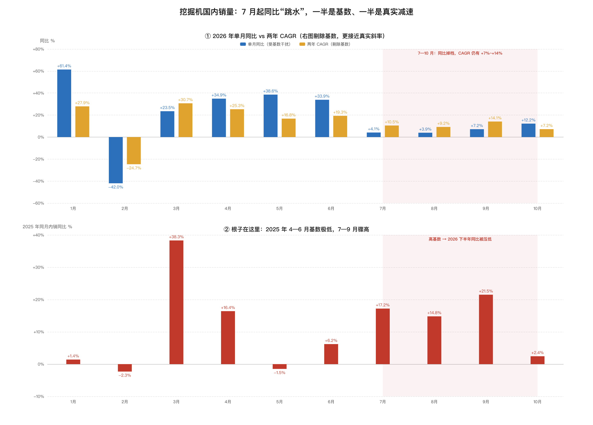
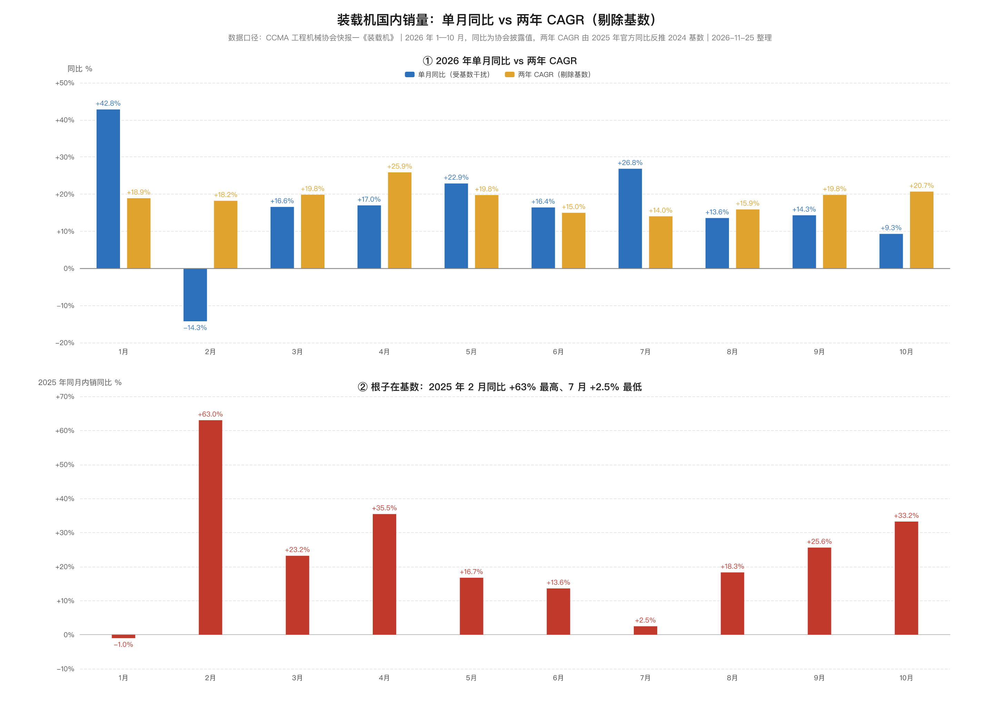
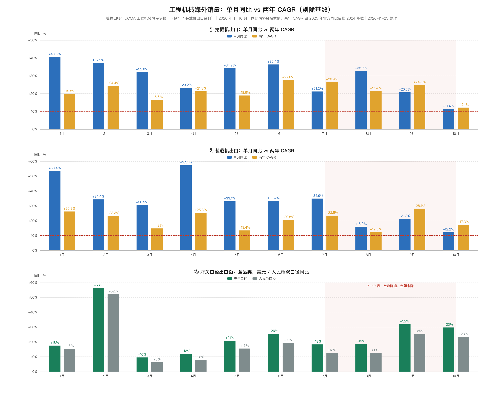
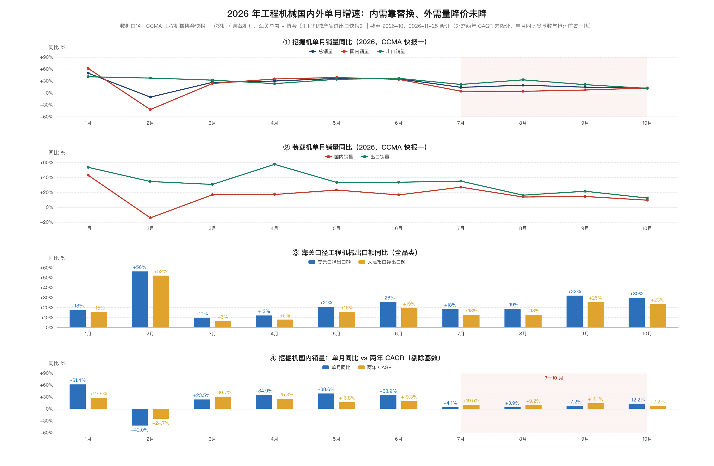

# 工程机械行业研究（2026 年三季报）

> **独立行业研究**（写作基准：2026-11-25；覆盖范围：全球工程机械，焦点为中国厂商与北美龙头对照；利润池口径：代表公司 2025 年报聚合 + 行业协会销量口径；行业基线：2025 年报 + 2026-10 月度快照；数据边界：协会月度销量至 2026-10、海关出口额至 2026-10、中国厂商财报至 2026 三季报、卡特至 2026Q3、小松至 FY2026 上半年；下一节点：协会 11 月快报（12-07~12-10），约 2026-12-08；遵循 `doc/研报/研报模板/行业研究框架.md`）
>
> 相关公司报告：[三一重工](doc/研报/公司/机械设备/工程机械/三一重工/三一重工.md)
>
> 更新：2026-11-25。数据来源：中国工程机械工业协会（CCMA）月度快报一 / 快报二 / 《工程机械产品进出口快报》、海关总署、卡特彼勒与小松 IR、五家中国厂商 2026 三季报（`api/` 接口复算）。跟踪见"十、证伪与跟踪"。

**口径三条（读全篇前必读）**：

- **快报一 ≠ 快报二**：快报一含挖掘机 + 装载机（次月 7—10 日），快报二是起重 / 路面 / 桩工 / 工业车辆 / 高空（次月 16—18 日），两者**不可混算**；本报告的核心判断依赖快报二（非土方内销），只看快报一会把 10 月误读成"内外双旺"；

- **台数 ≠ 金额**：协会台数是 CCMA 口径、出口额是海关口径，**不能相除算单价**；单价只能用同口径的海关金额 ÷ 海关台数；

- **单月同比会被基数搅乱**：2026 年挖机内销单月同比已被基数搅乱 5 次（2 月 -42.0%、3 月 +23.5%、5 月 +38.6%、7 月 +4.1%、10 月 +12.2%），**判断趋势一律用两年 CAGR + 绝对量**。

## 一、结论卡片

| 项目 | 内容 |
| --- | --- |
| 一句话判断 | 全球总量在涨，中国厂商的利润没跟着涨；唯一还在涨的"出口"链条**斜率下了一个台阶（+23.9% → +18.5%）但未拐头**——**行业处在"量增 ≠ 利润增"的中前段，不是典型的上行周期** |
| 利润池 | 代表公司 2025 聚合：收入 2,867 亿、归母 242 亿、**净利率 8.4%**；池子分层极陡——零部件 25.0% > 卡特 14.5% > 中国整机 4.9%~9.4%。**恒立以 3.8% 的收入拿走 11.3% 的利润** |
| 核心矛盾 | **全球需求上行 vs 中国厂商利润上行**：北美增量在发电与数据中心（卡特 power & energy 占 42%），中国厂商增量在挖掘机出口——**两者不在同一个需求池**，利润率传导路径完全不同 |
| 周期位置 | **修复→上行（中前段）**，供给已出清（价格战结束、龙头 2026-05 集体提价），但出清红利只落在龙头与零部件，二线整机仍在被挤压 |
| 未来 12 个月最关键信号 | **9—10 月合并（消抢运错位）挖机出口两年 CAGR 是否跌破 +15%**（现 **+18.5%**，校正工作日 +19.0%）；辅以单月同比连续 2 月 <10%（10 月 +11.4%）。**主口径用合并窗口，单月只作预警** |
| 谁受益 / 谁受损 | 受益：**提价执行到位 + 海外结构重的龙头**（三一）、**不承担汇率与反倾销风险的零部件**（恒立）；受损：**内销占比高、提价传导弱的二线整机**（中联、柳工）、**非土方品类敞口大的厂商**、受反倾销切割的欧洲业务 |
| 证伪条件 | ① **9—10 月式合并窗口挖机出口两年 CAGR 跌破 +15%**（现 +18.5%）；② 单月同比连续 2 个月 <10%；③ 中国厂商 Q4 毛利率掉头向下。任一成立，本文"减速但未拐头"判断作废 |

**上期核对（2026 年 6 月 → 本期）**：上一期的四条核心判断，两条兑现、一条部分兑现、一条被证伪：

| 上期判断 | 结果 | 依据 |
| --- | --- | --- |
| 全球景气上行中前段、区域分化 | **兑现** | 卡特 Q3 收入 $207 亿（+17%）创单季新高、在手订单 $780 亿近乎翻倍 |
| 中国内需低基数修复、成色待验证 | **部分兑现** | 量确实修复（1—10 月内销 +15.9%），但**利润没有修复**：四家整机 9M 扣非全负 |
| 受益标的 = 海外敞口大的整机 + 恒立 | **部分兑现** | 恒立 +29.8% 最干净；但海外占比最高的中联（59%）利润 -25.7%，**海外占比不能直接推出利润** |
| "外需降速"（10 月出口腰斩） | **半对半错** | 说"拐点"错（合并窗口仍 +18.5%）；说"降速"对（7—8 月 +23.9% → 9—10 月 +18.5%，**下了一个 5.4pp 的台阶**）。**旧稿用 7—10 月合计 +21.1% 把台阶平均掉了，本期改为合并窗口** |

> **上期最重要的方法纠错（本期再修一次）**：① 用**单月同比**判断外需会误判——基数会把 +21% 读成"腰斩"；② 但用**固定区间合计**同样会误判——7—10 月合计把抢运前的强（7—8 月 +23.9%）与抢运中的弱（9—10 月 +18.5%）平均成 +21.1%，**把真实台阶抹平了**。
>
> **本期定下主口径：判断外需趋势一律用「连续 2 个月合并窗口的两年 CAGR」**——合并窗口能同时消除两类干扰：基数失真（用两年 CAGR）与发运错位（用合并而非单月）。**窗口选错，结论就会错两次：一次是误判拐点，一次是把减速读成无事。**

## 二、行业与利润池

**行业本质**：工程机械赚的是**"周期弹性 + 后市场 + 电动化"**三笔钱——整机是强周期资本品，需求跟采矿、基建、地产、数据中心资本开支走；利润弹性来自销量周期的经营杠杆，持续性来自后市场占比提升。

**边界与口径**：本报告以**土方机械（挖掘机为前周期代表）**为核心口径——挖掘机比整体土方机械复苏更早，是最好的先行品种。中国销量取 CCMA 快报一（挖机 + 装载机，均含电动）。全球土方销量为 Off-Highway Research 口径，海外区域发货为 AEM 口径。

**产业链与利润分配（2025 年报，样本聚合口径）**：

| 环节 | 代表 | 2025 收入（亿元） | 2025 归母（亿元） | 毛利率 | 净利率 | ROE |
| --- | --- | ---: | ---: | ---: | ---: | ---: |
| 上游零部件 | 恒立液压 | 109.4 | 27.3 | **41.6%** | **25.0%** | 16.6% |
| 整机（国内龙头） | 三一重工 | 897.0 | 84.1 | 27.5% | 9.4% | 11.2% |
| 整机 | 中联重科 | 521.1 | 48.6 | 28.0% | 9.3% | 8.3% |
| 整机（收入最大） | 徐工机械 | 1,008.2 | 65.7 | 22.6% | 6.5% | 11.0% |
| 整机（体量最小） | 柳工 | 331.4 | 16.1 | 22.4% | 4.9% | 9.0% |
| **合计（样本）** | 五家 | **2,867.1** | **241.8** | — | **8.4%** | — |
| 整机（海外对照） | 卡特彼勒 | — | — | — | 14.5% | **57.0%** |

> **这张表告诉我们两件事**：① **利润池是倒金字塔**——零部件环节以 3.8% 的收入拿走 11.3% 的利润，净利率是整机的 2.7—5.1 倍；整机内部则按毛利率分三层（27% 档：三一 / 中联；22% 档：徐工 / 柳工），4pp 的毛利率差直接对应 4.5pp 的净利率差。② **卡特的 57% ROE 不可直接比**——它由回购与杠杆抬高，与中国厂商 8—11% 的 ROE 不是同一件事；**可比的是净利率**：14.5% vs 4.9%~9.4%。

**利润堆在哪里、为什么**：

- **零部件**：技术壁垒（液压件是挖机成本与性能的核心）+ 客户分散（不押注单一整机厂）+ 不承担整机厂的汇率与反倾销风险 → 三重优势叠加，是产业链唯一"旱涝保收"的环节；

- **整机龙头**：品牌 + 经销商网络 + 后市场（配件与服务毛利高于整机）+ 金融租赁 → 卡特的定价权来源；中国龙头刚恢复其中一部分（2026 年才结束三年价格战）；

- **二线整机**：产品同质化、只能打价格战 → 毛利率 22% 档，净利率 5% 上下，**周期上行时弹性小、下行时先亏**。

**板块整体利润量级**：中国工程机械行业规上企业利润总额未取得公开月度口径，**本报告不推算**（避免用样本聚合冒充全行业）；上文 2,867 亿收入 / 242 亿归母是**五家代表公司聚合，不代表全行业**。

## 三、量

**需求三层拆开看**：

- **存量替换（占比最大，最确定）**：中国 2019—2021 高峰销售的近百万台挖机（2021 年单年 34 万台）进入 5—8 年置换窗口，是本轮内销的主引擎。**这决定了内销的底，但给不出弹性**——替换需求释放完，增速自然回落。

- **新增渗透（增量所在，但与中国厂商错位）**：北美 **AI 数据中心基建**（发电、冷却、厂房）是 2026 年全球最强增量，卡特 Q3 power & energy $88 亿（+18%，其中发电 +30%）、占其收入 42%。**这块需求买的是燃气发电机组与工程服务，中国工程机械厂商基本没有对应产品**。中国厂商的增量在挖掘机出口（累计 +28.4%），对应的是新兴市场采矿与基建——**两个需求池不重叠，这是"全球景气 ≠ 中国利润"的根源**。

- **结构升级（决定单价）**：电动化（电动挖机 TCO 较柴油低 40%+，封闭场景先渗透）与大型化（矿用大挖是高毛利品类）。**电动化目前只在中国装载机上兑现**（见"七、变量"）。

**支付方与支付能力**：国内支付方是**财政与地产**——1—8 月固投 -7.2%、基建累计 -3.6%、地产开发投资 -19.2%、新开工 -24.0%。**房企与地方财政同时在收缩，这是内销量增却开工率不增的根本原因**（10 月开工率 52.5%、同比 -2.48pct，连续两月同比为负）。海外支付方是**矿企与主权基建**，付款能力随大宗价格波动——挖机需求与油价相关性弱（采矿资本开支看的是项目回报而非当期油价），这是出口比内销更稳的原因。

**空间测算（TAM → SAM）**：全球土方机械 2025 年销量 +2%，Off-Highway Research 预计到 2030 年北美、印度土方销量创历史新高。**本报告不做全球规模金额测算**——公开口径以台数与增速为主，金额口径缺统一来源，硬凑会失真。可用的锚是：**中国 2026 年前 10 个月挖机 23.4 万台，年化约 28 万台，仍是 2021 年（34 万台）的 82%**——即当前仍处于"从底部回升"，而非"超越上一轮峰值"。

**成色判断**：

| 需求来源 | 成色 | 判定依据 |
| --- | --- | --- |
| 中国内销 | **更新替换 + 电动化替代**，不是施工量扩张 | 土方内销正增长的同时，**非土方内销全线负增长**（压路机 -11.2%、摊铺机 -22.2%、履带吊 -46.4%）；开工率同比仍 -2.48pct |
| 中国出口 | **内生**（新兴市场采矿资本开支），但均价在降 | 出口台数 +28.4%，出口金额增速慢于台数，**挖机整机单价同比转负**（-3.0%） |
| 北美 | **政策 + 资本开支驱动**，集中度高、波动大 | AI 数据中心是真增量，但卡特 resource industries 终端零售仅 +4%，**订单强、终端弱** |
| 欧洲 | **衰退底部** | 房建开工十年低位，10 月对欧出口额 **-32%**（唯一负增长洲） |

### 出口斜率：外需在减速，但没有拐头——用合并窗口读，别用单月、也别用固定区间

10 月挖机出口同比从 +20.7% 掉到 +11.4%，核心原因是**抢出口错位**：9 月 12,806 台是历史最高的 9 月（中秋 9/25—27、国庆 10/1—7，节前截单窗挤到 9/28—30），把 10 月订单提前发了。**错位意味着 9 月虚高、10 月虚低，两个月的偏差方向相反、大小近似**——所以正确做法是**把 9 月与 10 月合成一个窗口**，让偏差在同一口径内抵消。

**三个窗口，三个不同的故事**（挖机出口两年 CAGR）：

| 窗口 | 是否消除错位 | 两年 CAGR | 结论 |
| --- | :---: | ---: | --- |
| H1（1—6 月） | 无关错位 | +21.3% | 基准 |
| 7—8 月（抢运**前**） | ✓ | **+23.9%** | **本年实际是加速的** |
| **9—10 月合并（主口径）** | **✓** | **+18.5%** | **降了一个 5.4pp 的台阶，未拐头** |
| 7—10 月（旧稿窗口） | **✗** | +21.1% | **把强、弱两段平均，台阶被抹平** |
| 10 月单月 | **✗** | +12.1% | **被错位放大，假破位** |

> **这张表告诉我们三件事**：① **拐点没有发生**——9—10 月合并仍有 +18.5%，正增长、两位数，谈不上"外需失速"；② **但减速是真实的**——从抢运前的 +23.9% 降到 +18.5%，**5.4pp 的台阶**，不是噪音；③ **旧稿的 7—10 月窗口 +21.1% 是最容易误导的一个**——它把抢运前（强）与抢运中（弱）平均，正好把台阶抹平，得出"区间未变"的错觉。
>
> **所以这个问题的正确答案不是"能判断 / 不能判断"，而是"必须换一个窗口才能判断"。** 单月同比错（假破位），固定区间也错（假平稳），**只有合并窗口给出真实的 +18.5%。**

**交叉验证：装载机方向相反，说明这不是外需拐点**

| 品类 | 7—8 月（抢运前） | 9—10 月合并 | 变化 |
| --- | ---: | ---: | ---: |
| 挖机出口 两年 CAGR | +23.9% | **+18.5%** | **-5.4pp（减速）** |
| 装载机出口 两年 CAGR | +17.8% | **+22.6%** | **+4.8pp（加速）** |

> **这一组反向数据是本文最硬的证据**：如果 9—10 月走弱是全球外需问题，装载机不会同步走高。**挖机减速、装载机加速 → 更可能是挖机品类自身的发运节奏错位与出口竞争加剧，而非外需拐点。**
>
> 这也说明了"用装载机验证挖机"为什么危险——**不是因为基数（旧稿的说法），而是因为两个品类的周期错位方向本来就可能相反。**

**工作日校正（必须披露的第三个口径）**：2026 年 9—10 月工作日 **38 天**，2025 年同期 **39 天**（中秋节 2026 年在 9/25、2025 年并入 10/1—10/8 长假），**少 1 天 ≈ 2.6%**。按天数校正后：

| 指标 | 未校正 | 日校正 |
| --- | ---: | ---: |
| 挖机出口 9—10 月合并同比 | +16.3% | **+19.3%** |
| 挖机出口 9—10 月合并两年 CAGR | +18.5% | **+19.0%** |
| 装载机出口 9—10 月合并两年 CAGR | +22.6% | **+23.2%** |

> 校正后挖机仍是 **-5.5pp** 的台阶、装载机仍是 **+5.0pp** 的加速，**方向与幅度都不因日历而改变**——这保证了上面的结论不是口径做出来的。

> **上图④的关键**：单月同比与两年 CAGR 的落差就是基数干扰的大小。7 月单月 +4.1%、两年 CAGR +10.5%（差 6.3pp，单月把减速夸大了）；5 月单月 +38.6%、CAGR +16.8%（差 21.7pp，单月把加速也夸大了）。**单月同比在 2026 年已被基数搅乱 5 次，任何趋势判断都不能只看它。**

> **装载机与挖机的基数形态相反**，这是判断内需真伪时最容易踩的坑：2025-07 装载机基数只有 +2.5%（全年最低）、而挖机是 +17.2%（全年最高），所以 2026-07 装载机内销 +26.8%、挖机只有 +4.1%——**同一个月差 22pp，根子在基数，不是装载机需求突然变好**。用装载机验证挖机会得出完全相反的结论。

> **上图是本节的核心证据**：① 挖机与装载机出口的单月同比（蓝柱）全年从 +40%/+53% 一路降到 +11%/+12%，**看起来是持续降速**；但两年 CAGR（黄柱）除 10 月外一直稳定在 +17%~+28%——**口径一换，"降速"就消失了**。② 10 月黄柱第一次掉进 +12%~+17%，**这是全年唯一一次真实斜率下行**，也是本文把 10 月列作预警而非噪音的原因。

> **上图③的口径陷阱**：海关出口额美元口径 10 月 +29.7%、人民币 +23.4%，**量（台数）在降、额（金额）在升**——不能由此推出"出口单价上升"，因为全品类金额含非土方与零部件（压路机 +42.2%、平地机 +43.0%、叉车 +25.9%）。**拆到挖机单品，金额 +8.1% 慢于台数 +11.4%，单价是 -3.0% 的**。这两件事方向相反，必须分开说。

> **本节结论**：量增是真的（挖机 1—10 月 +22.0%），但**增量的质量在下降**——内销靠替换（一次性、会衰减）、出口靠以价换量（单价 -3.0%）、最强的增量（北美数据中心）与中国厂商无关。未来三年量增区间给 **+4%~+10%**，其中 2027 年最主观的假设是"内销替换需求不熄火"，用**两年 CAGR 连续 2 个月跌破 +5%** 作先行指标。

## 四、供

**这个行业的成本曲线不是资源曲线，是"规模 + 自制率 + 产品结构"曲线。** 工程机械没有矿山那样的现金成本排序，真正决定谁活得下来的是：单台制造成本（规模效应 + 零部件自制率）、产品结构（大挖 / 高端占比）、以及**能不能在价格战中守住毛利率**。所以本报告用**毛利率分层 + 提价执行力**作为成本曲线位置的代理指标。

**成本分层（9M 2026 毛利率，代理成本曲线）**：

| 分层 | 公司 | 9M 毛利率 | 同比 | 位置判读 |
| --- | --- | ---: | ---: | --- |
| 安全区 | 恒立液压 | 39.6% | **-2.4pct** | 绝对水平最高，但**在往下走**——整机厂压价传导到零部件 |
| 安全区 | 三一重工 | 28.0% | **+0.4pct** | **唯一同比改善的整机厂**，提价执行到位 |
| 挤压区 | 中联重科 | 27.1% | -1.0pct | 毛利率不低但收入失速（Q3 收入仅 +4.7%） |
| 危险区 | 徐工机械 | 22.4% | +0.1pct | 几乎没动，提价未传导 |
| 危险区 | 柳工 | 21.3% | -1.0pct | 最低，且在下行 |

> **关键读法：不看出毛利率绝对水平，看同比方向。** 2026 年 5 月全行业提价的背景是成本上行（钢材 / 铜 / 橡胶），**提价能否覆盖成本，唯一证据就是毛利率同比**。五家里只有三一为正——**这意味着成本上涨被三一消化、被其余四家自己承担了**。

**供给结构与扩产**：全球龙头资本开支温和，无无序扩产；中国三年价格战已淘汰一批产能，龙头 2026 年率先提价说明供给纪律恢复。当前唯一主动扩产方向是**电动化产线**与**海外本地化基地**（规避关税与反倾销）。

**壁垒（防的是谁）**：

- **液压件（恒立）**：防的是整机厂自制与外资替代。恒立的核心不是产能，而是**进入卡特 / 小松供应链的认证周期**——这是时间壁垒，不是资本壁垒；

- **整机龙头（三一 / 徐工）**：防的是二线厂与跨界者。壁垒是**经销商网络 + 后市场服务半径**——挖机卖出去要用 8 年，服务网络断了客户就跑了，这不是降价能抢的；

- **品牌（卡特）**：防的是性价比竞争。壁垒是**后市场与金融租赁**——卡特卖的不只是机器，是"设备 + 融资 + 全生命周期服务"。

**库存三处一起看**：

| 环节 | 位置 | 证据 |
| --- | --- | --- |
| 海外渠道 | **补库后半段已走完** | 2026 年 1—4 月海外挖机发货 / 零售 = 1.06（补库）；10 月出口环比 -16.3%，年底转向去库存与订单观望 |
| 龙头订单 | **历史高位，但与终端背离** | 卡特在手订单 $780 亿（近乎翻倍），但 resource industries 终端零售仅 +4% |
| 中国渠道 | **偏弱** | 开工率同比 -2.48pct 连续两月为负；非土方内销全线负；上半年 312 家代理商注销、平均库存周转超 200 天 |

**出清五问**：

1. **多少产能在盈亏线下、亏了多久**：三年价格战把二线整机净利率打到 4.9%（柳工），已接近盈亏线；但**行业没有出现大规模关停**——工程机械是组装业，退出成本低，表现为"代理商注销"（上半年 312 家）而非"工厂倒闭"。

2. **在建产能还要投放多少**：无大规模扩产。扩产集中在电动化产线与海外基地，不构成供给压力。

3. **有没有强制退出机制**：**没有**。不像钢铁 / 水泥有环保限产，工程机械只有价格淘汰——这决定了出清**慢而不彻底**。

4. **龙头是否在逆势扩产**：**否**。三一 / 徐工资本开支温和，未见逆势扩产 → **这是出清基本完成的最强证据**。

5. **开工率与关停家数往哪走**：中国开工率 52.5%（同比 -2.48pct、环比 +0.08pct），**环比走平、同比仍负**；代理商持续注销（渠道出清）。

> **出清判定：已出清（价格战结束、龙头 2026-05 集体提价），但出清红利未平均分配。** 确认信号是**龙头提价后毛利率同比转正并站稳**——三一已做到（+0.4pct），其余四家没有。**"龙头逆势扩产"这个未出现的事实，比任何价格信号都更能说明出清到位。**

## 五、价与单位利润

**价格形成机制**：**供需定价为主 + 龙头品牌溢价**。全球层面卡特靠品牌、独家经销商与后市场具备独立定价权；中国层面行业在 2023—2025 年价格战中把价格权打没了，**2026 年才刚恢复**。

**价格现状**：

- **2026 年 5 月三一起头全系列挖机 +5%**，8 月扩展至起重机 +2~5%，徐工、柳工跟涨，混凝土机械同步进入提价通道——这是"从抢份额转向要利润"的标志性事件；

- 本轮提价有成本端支撑（2026Q2 以来钢材 / 铜 / 橡胶上涨），终端接受度高于 2021 年那轮纯涨价；

- **出口端是反向的**：10 月挖机整机出口金额 +8.1%，慢于台数 +11.4%，**单价同比 -3.0%**（9 月为金额 +15.4% vs 台数 +20.7%，7 月更极端：金额 +2.65% vs 台数 +21.2%）——**海外在以价换量**。

**定价权测试（三条，逐条给结论）**：

| 测试 | 证据 | 结论 |
| --- | --- | --- |
| ① 历史上提价成功过吗 | 2026-05 挖机 +5%、2026-08 起重机 +2~5% 落地，是三年价格战后首次 | **部分通过**——能提，但幅度小（5%） |
| ② 下行期毛利率守住过吗 | 2024→2025：三一 26.9%→27.5%、柳工 22.2%→22.4%，下行期未崩 | **通过**——说明底部有支撑 |
| ③ 涨价后客户跑了吗 | 三一挖机国内十五连冠、全球八连冠，份额未掉 | **通过** |

> **定价权结论：中国龙头是"有限定价权"**——能提价 5%、能守住毛利率，但提不动更多（受二线跟涨与出口竞争约束）。**卡特是"强定价权"**（连续提价 + 后市场涨价），小松居中。**反倾销会直接削弱中国厂商在欧洲的定价权**：终裁税率一旦落在 25%—35%，欧洲终端价需上涨或让利对冲，量价双压。

**传导链**：成本上涨（钢 / 铜 / 橡胶）能否转嫁，2026 年的答案是**分层**——三一转嫁成功（毛利率 +0.4pct）、徐工勉强（+0.1pct）、中联与柳工转嫁失败（各 -1.0pct）。**同一轮成本上涨，四种结果，说明"行业提价"不是普涨，而是龙头的单边行动。**

**单位利润**：单台 / 单吨口径的公开数据不足，**本报告不推算单台利润**（避免用台数与收入除出伪精确值——台数是协会口径、收入是财报口径，两者不可相除）。可用的替代读法是**毛利率 × 产品结构**：

- 三一海外毛利率 31.6% vs 国内 20.7%，**海外毛利占比约 71%**——单位利润的改善来自"卖到哪里"，不是"卖多少台"；

- 恒立毛利率 39.6%，是整机的 1.4—1.9 倍——**单位利润最高的位置在上游，不在整机**。

**本节产出**：单位利润方向 **分化**（龙头向上、二线向下、零部件高位回落）；定价权 **有限**（三条测试两条通过、一条部分通过）。

## 六、分配

**议价权迁移方向**：

- **利润向"上游零部件"与"提价执行到位的龙头"两端集中，中间的二线整机被挤压。** 2026Q3 的证据：恒立净利率 21.0%（整机厂的 2—4 倍）、三一毛利率 28.0%（唯一改善）、中联 -25.7%、柳工 H1 拖累致 9M -9.1%；

- **海外高毛利是国内利润修复的路径**：三一海外毛利率是国内的 1.53 倍，本轮利润弹性靠海外结构，不靠国内多卖挖机。

**集中度**：三一挖掘机全球销量八连冠、国内十五连冠；全球格局为卡特 / 小松 / 三一 / 徐工 / 中联 / 日立分层。**行业调整期龙头持续吃小厂份额**——2023—2025 价格战中，二线厂毛利率跌到 22% 档、净利率 5% 上下，而龙头守住 27% 档。

**份额窗口（本轮最有价值的下注点）**：

- **谁在吃份额**：三一（连续提价仍不失份额）+ 恒立（进入卡特 / 小松供应链）；**凭什么吃**：三一靠海外渠道与提价执行力、恒立靠认证周期构成的时间壁垒；

- **能吃到什么时候**：吃到**出口斜率走平为止**。当前 9—10 月合并两年 CAGR **+18.5%**（校正日 +19.0%），已比抢运前 +23.9% 降了一个台阶；**一旦合并窗口跌破 +15%，三一的份额故事就失去增量支撑**；

- **反向的窗口**：二线整机（中联、柳工）在价格战中份额未丢但利润已薄——**若内销从替换需求扩散到非土方（施工量真起来），它们弹性最大**；这正是"九、标的映射"里柳工排在中联之前的原因。

**财务验证**：

| 公司 | Q3 单季归母同比 | 9M 累计归母同比 | H1 归母同比（自算） | 读法 |
| --- | ---: | ---: | ---: | --- |
| 三一重工 | **+20.6%** | +12.2% | +9.1% | 逐季改善，趋势确认 |
| 柳工 | **+14.7%** | **-9.1%** | -13.5% | **Q3 转正但 H1 拖累太深**，单季改善 ≠ 趋势改善 |
| 徐工机械 | +1.7% | -6.2% | -9.5% | 微弱改善 |
| 中联重科 | **-25.7%** | -24.5% | -24.0% | 全年失速，无改善 |
| 恒立液压 | +9.1% | +3.2% | +0.5% | 增速高但利润率在降 |

> **这张表纠正一个常见误读**：四家整机 Q3 单季除中联外全部同比改善，**看起来像"行业见底回升"**；但 9M 累计四家里三家仍是负增长——**改善发生在三季度，前两季拖累太深**。柳工是最典型的例子：Q3 +14.7%，9M 仍 -9.1%。**单季改善不构成趋势，要 Q4 累计同比转正才算数。**

## 七、变量

**政策——欧盟对华移动式起重机反倾销（唯一改写"价"的外生变量）**：

- **时间线（口径已修正，旧稿的 2026-09-19 系 2021 年前 9 个月规则，已废）**：2025-12-19 立案 → 2026-02-28 起进口登记（登记期 9 个月，约至 2026-11-28）→ **初裁法定窗口 2026-08-19，已过且未见临时措施** → **终裁 2026-12-19 常规 / 2027-02-19 法定硬顶**；

- **改写的是哪一条**：**改写"价"与"分配"**——税率落在 25%—35% 基准区间，欧洲终端价需上涨或让利对冲，中国厂商欧洲业务量价双压；

- **风险形态**：初裁无临时税 → 不是"先征后退"，而是**终裁一次性追溯**，追溯期即登记期。10 月对欧出口额 **-32%**（唯一负增长洲），已连续多月为负——**壁垒的影响已经在数据里**；

- **落地信号**：2026-11 中下旬"最终披露"（税率最早泄露）。

**技术与电动化（改写"供"的外生变量）**：

- **改写的是哪一条**：**移动成本曲线**——电动化的本质是把"燃料成本"换成"电费 + 电池折旧"，在电价低、工况封闭的场景把客户 TCO 降 40%+，等于重画了供给端的性价比排序；

- **当前进度两极分化**：**装载机已进入主流替代**（1—10 月国内电动装载机 37,631 台、渗透率 **58.6%**，10 月单月 **64.1% 创历史新高**）；**挖掘机仍是起步期**（电动挖机仅 812 台，占内销 **0.71%**，10 月单月 1.93%）；

- **出口侧电动化仍早**：电动装载机出口 3,914 台（渗透率 6.05%）、电动挖机 426 台（0.35%）——**电动化是"国内更新替换的抓手"，不是"出海溢价来源"**；

- **落地信号**：电动挖机渗透率站稳 5%（现 0.71%），才说明电动化从装载机扩散到挖机。

**美国关税**：卡特 Q3 关税成本 $6 亿，属其自身成本项，不直接改写中国厂商的供给——**写不出改写路径，故不单列**。

## 八、位置与情景

**位置与读数要分开**：

- **位置（阶段判断）**：**修复 → 上行中前段**。依据是供给端——价格战结束、龙头提价、无逆势扩产、代理商出清（"四"的出清五问全部指向已出清）；

- **读数（当前指标）**：销量增速高位（+22.0%）、开工率同比为负（-2.48pct）、利润率分化。**读数看起来矛盾，是因为销量反映的是替换需求与出口，开工率反映的是施工量——两者本来就不是一回事**；

- **两者冲突时以结构为准**：开工率同比为负 + 非土方内销全负 + 出口单价转负 = **"量增"的结构比读数弱**。这是把位置定在"中前段"而非"上行中段"的原因。

**三档情景（挖机销量口径，2027—2029）**：

| 情景 | g1（2027） | g2（2028） | g3（2029） | 触发条件 |
| --- | ---: | ---: | ---: | --- |
| 悲观 | +2% | 0% | +2% | **合并窗口挖机出口两年 CAGR 跌破 +15%**（现 +18.5%）且单月同比连续 2 月 <10%；内销两年 CAGR <+5% |
| 基准 | **+9%** | **+7%** | **+5%** | 内销替换需求延续（两年 CAGR +8~10%）、**出口从合并口径 +18.5% 再降一档至 +10~13%** |
| 乐观 | +15% | +11% | +8% | 非土方内销转正（施工量真起来）+ **出口合并口径守住 +18% 以上** |

**基准情景的推导（不是拍的）**：

- 2026 全年挖机估 **28.2 万台（+19.8%）**——1—10 月 23.45 万台，11—12 月按 2025 年同期（4.31 万台）加约 10% 增长补 4.74 万台；**注意：全年增速会低于 1—10 月的 +22.0%，因为 2025Q4 基数不低**；

- 2027 内销：2026 内销约 13.7 万台 × (1 + 两年 CAGR +7%) ≈ 14.6 万台；出口约 14.5 万台 × (1 + 12%) ≈ 16.2 万台；合计约 30.8 万台 → **+9%**；

- 2028—2029 递减至 +7% / +5%——替换需求池逐年消耗，且基数抬高；

- **出口假设的依据（本期修订）**：2027 年出口取 +12%，是**以 9—10 月合并口径 +18.5%（校正日 +19.0%）为起点、再降一档**——依据是合并窗口已比抢运前的 +23.9% 下了 5.4pp 台阶，**减速是趋势性的而非一次性**。若沿用旧稿 7—10 月的 +21.1%，2027 出口会高估 2—3pp，进而把基准 g1 高估约 1pp。

**市场当前定价的是哪一档**：**无法判断**。工程机械无统一行业指数、四家整机估值分化极大（中联与徐工 PE 差异反映的是利润质量而非行业预期），用龙头隐含增速反推会混入个股因素。**按框架要求明说：此项不推断。**

## 九、标的映射

| 标的 | 定位 | 利润兑现路径（含关键假设） | 一次性收益 | 对应公司报告 |
| --- | --- | --- | --- | --- |
| **恒立液压** | 直接受益（卖水人） | 收入 +29.8% 快于所有整机厂，进入卡特 / 小松供应链；**假设：整机厂压价不加剧**（9M 毛利率已 -2.4pct，是唯一风险） | 无重大项 | — |
| **三一重工** | 直接受益（首选整机） | 海外收入 61%、毛利占比 71%，提价执行唯一到位；**假设：出口两年 CAGR 守住 +15%、人民币不破 6.5** | Q3 汇兑损失 8.6 亿（套保后归母仍 +20.6%，扣非 -5.4%） | [三一重工](doc/研报/公司/机械设备/工程机械/三一重工/三一重工.md) |
| 柳工 | 间接受益（弹性） | Q3 单季 +14.7% 但 9M -9.1%，**弹性来自"非土方内销转正"这一假设**，尚未发生 | 无重大项 | — |
| 徐工机械 | 间接受益 | 收入体量最大（Q3 256 亿 > 三一 249 亿）但毛利率唯一没动的 22% 档 | 无重大项 | — |
| 中联重科 | **受损** | 毛利率 27.1% 不低，但 Q3 收入仅 +4.7%、归母 -25.7%、扣非 -39.9%，**收入失速是根因，不是成本问题** | 无重大项 | — |
| 卡特彼勒 | 对照（不排序） | 净利 +43%、订单 $780 亿，但 resource industries 终端零售仅 +4% | 关税成本 $6 亿 | 无（对照基准） |
| 小松 | 对照（不排序） | FY2026H1 收入 +14.1%、净利 +9.2%，**收入快于利润，营业利润率被压缩** | 无 | 无（对照基准） |

**排序逻辑（按利润兑现度，不按海外占比）**：恒立 > 三一 > 柳工 > 徐工 > 中联。

**排序与"海外占比"不一致，这是刻意的**：海外占比排序是三一 61% > 中联 59% > 徐工 48% ≈ 柳工 48%，但中联海外占比第二高、利润却 -25.7%。原因有三：① 零部件不承担汇率与反倾销；② 提价执行率决定毛利率（三一 28.0% vs 徐工 22.4%）；③ 收入体量与增速的取舍。**买行业景气 ≠ 买海外占比最高的整机厂——这是本期最需要修正的一条映射逻辑。**

> **一次性收益说明**：五家整机 / 零部件 2026Q3 均无重大非经常性损益（三一 Q3 扣非 +20.4% 与归母 +20.6% 基本一致，差 0.2pct 即套保与汇兑的时间差）；**本表不涉及"归母增长由一次性驱动"的情形**，与创新药等行业的处理不同。

## 十、证伪与跟踪

**证伪条件（三条，每条对应结论卡片的一句判断）**：

1. **合并窗口（连续 2 个月）出口两年 CAGR 跌破 +15%**（现 9—10 月 **+18.5%**）→ 说明"减速但未拐头"判断错。**这条是主条件**——它同时消除两类干扰：基数失真（用两年 CAGR）与发运错位（用合并窗口）。**禁用两种错口径：单月 CAGR（10 月 +12.1% 是错位放大的假破位）、7—10 月固定区间（+21.1% 抹平了台阶）**；

2. **挖机出口单月同比连续 2 个月 <10%** → 辅助条件（单月受错位干扰，仅作预警）。10 月已 +11.4%，11 月（快报一 12-07~12-10）为第一个观察点，**但裁决要看 10+11 月合并，不能只看 11 月单月**；

3. **中国厂商 Q4 毛利率掉头向下（三一跌破 27.5%）** → 说明"出清红利兑现"判断错，提价被成本吃掉了。

**仪表盘（全文指标只在这里出现一次）**：

| 层级 | 指标 | 阈值 / 信号 | 频率 | 来源 |
| --- | --- | --- | --- | --- |
| 先行 | CCMA 挖机出口单月同比 | **连续 2 月 <10% = 外需驱动结束**（10 月 +11.4%） | 月度 | 协会快报一 |
| 先行 | 挖机 / 装载机出口**两年 CAGR（连续 2 个月合并窗口）** | **合并窗口 <+15% = 真实斜率走平**。现挖机 9—10 月 **+18.5%**（抢运前 +23.9%，**-5.4pp 台阶**）；装载机 **+22.6%**（+4.8pp，**反向**）。**禁用单月同比（错位）与固定 7—10 月区间（抹平台阶）**；工作日 38 vs 39 天，校正后 +19.0% | 月度 | 协会快报一 |
| 先行 | 卡特彼勒在手订单 | <$650 亿或连续两季环比下降 = 全球拐点（现 $780 亿） | 季度 | 卡特 IR |
| 同步 | 挖机内销**两年 CAGR** | **连续 2 月 <+5% = 国内修复证伪**（现 7—10 月 +10.2%） | 月度 | 协会快报一 |
| 同步 | 快报二：非土方内销（压路机 / 摊铺机 / 履带吊） | **非土方转正才是"施工量真起来"**；土方正 + 非土方负 = 结构性替代（10 月压路机 -11.2%、摊铺机 -22.2%、履带吊 -46.4%） | 月度 | 协会快报二 |
| 同步 | 开工率（**分品类**） | 总量同比转正且站稳 50%+；**总量 52.5% 是土方权重假象**，压路机仅 31.4%、摊铺机 39.1% | 月度 | 协会 / 央视财经 |
| 同步 | 海关出口额（美元 + 人民币双口径） | 增速与台数背离 = 结构变化或单价变动；**挖机整机金额增速 < 台数增速 = 单价转负**（10 月 +8.1% vs +11.4%） | 月度 | 协会进出口快报 |
| 同步 | 电动装载机 / 电动挖机内销渗透率 | 装载机站稳 55%+ = 替代确立（现 64.1%）；**挖机站稳 5% = 电动化扩散**（现 0.71%） | 月度 | 协会快报一 |
| 滞后 | 中国厂商毛利率（同比方向）与扣非 | 三一 28.0%（+0.4pct）是唯一改善；**四家整机 9M 扣非全负 = 利润传导失败**；扣非转正 = 传导恢复 | 季度 | 季报 / 年报 |
| 滞后 | 卡特 resource industries 终端零售 | 订单与终端背离（订单翻倍 vs 零售 +4%）连续两季不收敛 = 拐点前兆 | 季度 | 卡特 IR |

**合并窗口的算法（下期照此执行，避免口径漂移）**：

1. **窗口选择**：取**连续 2 个月**（如 10+11 月）合计，**不是单月、也不是 7—10 月式的固定长区间**——固定长区间会把强段与弱段平均，抹平台阶；

2. **两年 CAGR** = `√(窗口内 2026 合计 ÷ 窗口内 2024 合计) − 1`；2024 基数由 2025 年官方同比反推，不另设来源；

3. **工作日校正**（可选披露）：工作日本月差 >2% 时按天数等比校正，并在文中注明未校正与校正后两个值；

4. **同一窗口内比较**：只与**同季节位置的窗口**比（9—10 月 vs 去年同期、vs 抢运前 7—8 月），不跨季节比。

> **为什么坚持这一条**：同一个 10 月数据，用单月读得 +12.1%（破位）、用 7—10 月读得 +21.1%（无事）、用合并窗口读得 +18.5%（减速）。**三个数字、三个结论，选的窗口就是判断本身**——所以必须把窗口规则写死，否则下期又会换一个口径，判断无法积累。

**跟踪日历**：

| 时点 | 看什么 | 去哪找 | 验证哪条 |
| --- | --- | --- | --- |
| 每月 7—10 日 | 快报一：挖机 / 装载机内销与出口、电动渗透率 | CCMA | 证伪条件 ①②、内销两年 CAGR |
| 每月 16—18 日 | 快报二：非土方内销（**判断内需真伪的唯一分解口径**） | CCMA | "增量质量下降"判断 |
| 每月 20 日前后 | 进出口快报：出口额双口径、分洲结构 | CCMA / 海关 | 出口单价与结构 |
| 每月 5—6 日 | 开工率（分品类） | 协会 / 央视财经 | "量增工作量不增" |
| 每季 | 卡特 / 小松财报与指引、在手订单 | 公司 IR | 全球位置 |
| 每季 | 中国厂商毛利率与扣非 | 季报 | 证伪条件 ③ |
| 2026-11 下旬 | 欧盟反倾销"最终披露"（税率最早泄露） | 欧盟官方公报 | 欧洲定价权 |
| **2026-12-19** | **欧盟反倾销终裁（常规）/ 2027-02-19 硬顶** | 欧盟官方公报 | 二线整机欧洲敞口 |

**数据边界**：

- **已确认事实**：协会月度销量与开工率至 2026-10；海关出口额至 2026-10（10 月首次实现台数与金额同月）；中国五家厂商财报至 2026Q3；卡特至 2026Q3；小松至 FY2026 上半年（4—9 月）；

- **本报告推断**：三档情景 [g1,g2,g3]、2026 全年挖机 28.2 万台的估算、H1 归母同比（由 9M 减 Q3 自算）、上下游利润分配的结构性判断；

- **未取得、不推断**：行业规上企业利润总额（无公开月度口径）、单台利润（台数与收入口径不可相除）、市场隐含档位（无统一行业指数）。

**下一期（报告期 = 2026 年报，2027-03 前后）的关键读数**：① 11 月出口增速能否守住 10%（本文首要证伪条件）；② 四家整机 Q4 扣非能否转正；③ 非土方内销能否转正；④ 欧盟反倾销终裁税率与追溯范围。

---

> **历史版本**：[2026 年 6 月](2026年6月.md)（归档快照，口径与本期不同，勿直接对比数字）。**2026-11-25 按新版行业研究框架重写**：原十二节骨架改为十章经济链条，政策与技术合并为"变量"章，新增利润池测算、成本曲线分层、出清五问与三档情景 [g1,g2,g3]（旧版无行业增速输出，公司报告无法引用）；并清理了原文"外需降速"与"未降速"两处自相矛盾的结论。
>
> **同日二次修订（用户指出抢运错位）**：外需判断由"双口径（区间合计 + 单月）"改为**单一口径——连续 2 个月合并窗口的两年 CAGR**。原因：抢运错位下 9 月虚高、10 月虚低，单月口径会得出假破位（10 月 +12.1%）；而 7—10 月固定区间又把抢运前的强（+23.9%）与抢运中的弱（+18.5%）平均成 +21.1%，抹平真实台阶。合并窗口同时消除两类干扰，得 **+18.5%（校正工作日 +19.0%）**。结论从"未失速"改为**"在减速、未拐头"**；并用装载机反向验证（7—8 月 +17.8% → 9—10 月 +22.6%）证明这不是外需拐点，而是挖机品类的发运错位与出口竞争。
